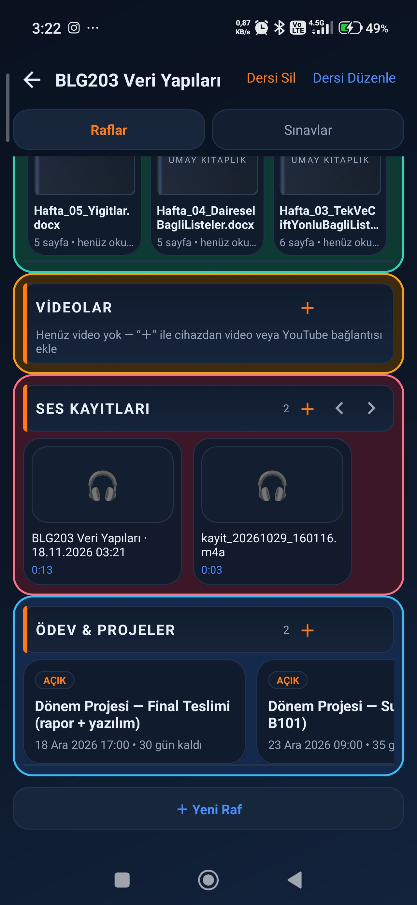
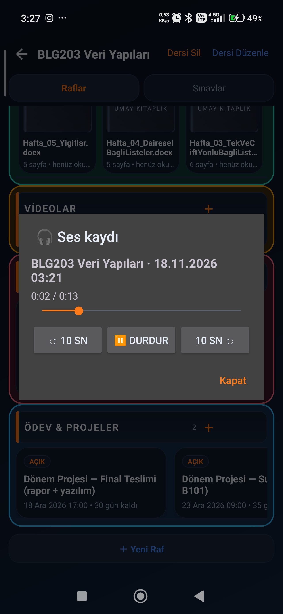
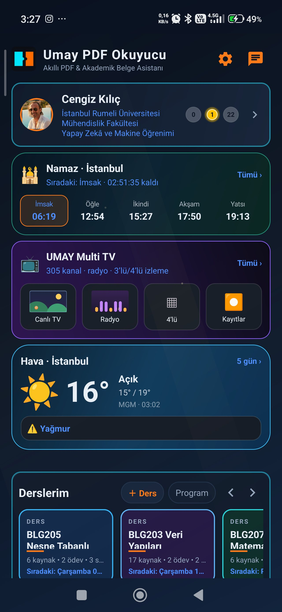
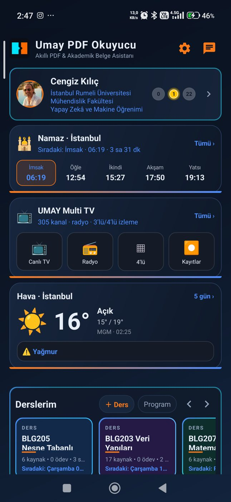
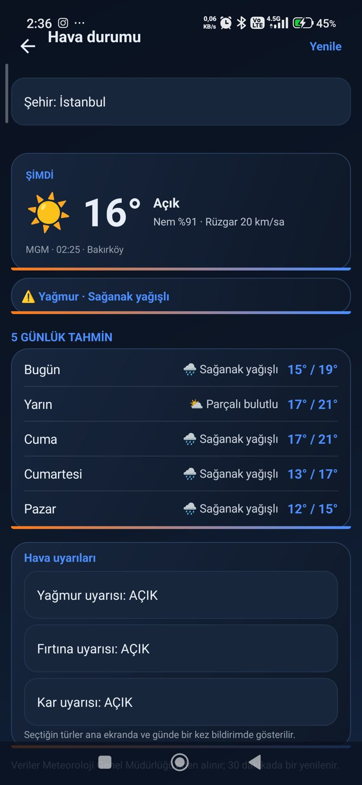
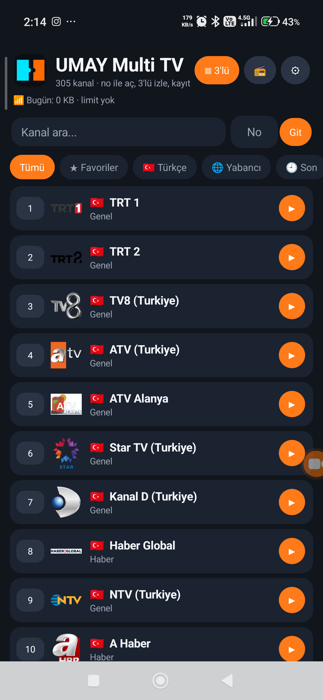
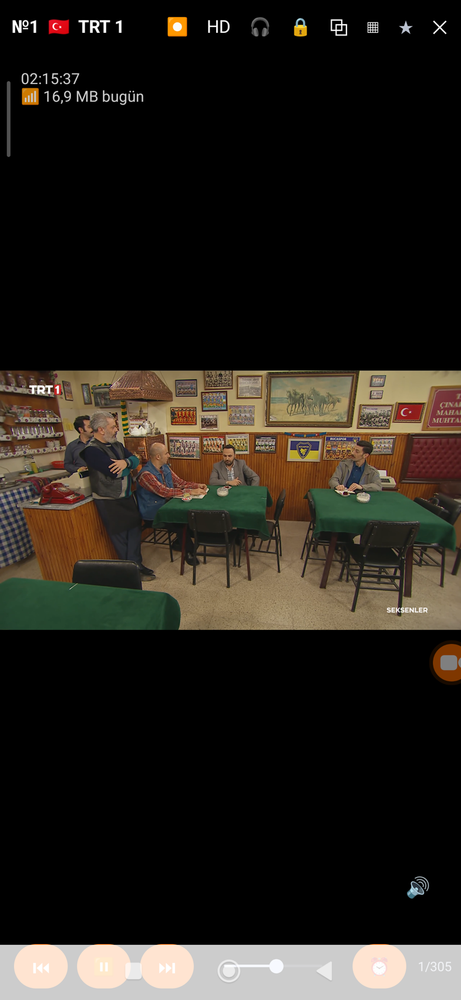
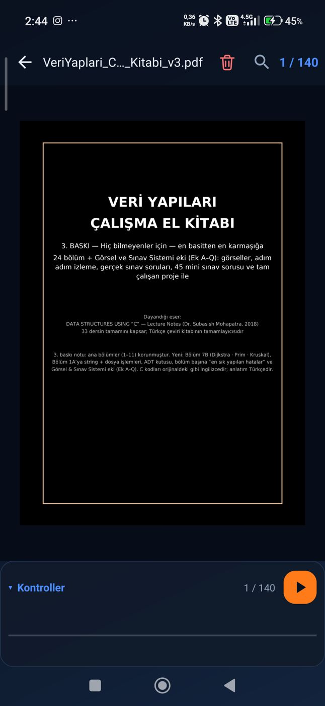

# UMAY PDF Reader

Telefonundaki **PDF, slayt, doküman ve resimleri açan**, **sesli okuyan**, içindekileri
**yapay zekâ ile açıklayan**, derslerini/sınavlarını takip eden ve kitaplığını raflara
ayıran Android uygulaması.

Üstüne **UMAY Multi TV** (305 canlı kanal + 49 radyo) ve **MGM hava durumu**
eklendi. Tek uygulama, tek APK.

## ⬇️ İndir (APK)

**Doğrudan indirme:**
[**UmayPdfReader.apk**](https://github.com/gecekargosu/umay-pdf-reader/releases/latest/download/UmayPdfReader.apk)

Telefonda bağlantıya dokun → dosya iner → üzerine dokun → **Yükle**.
“Yine de yükle” uyarısı normaldir (uygulama Play Store dışında dağıtılıyor).

**Sürüm:** 5.22 (kod 39) · Android 8.0+ · ~63 MB

## 📸 Ekran Görüntüleri (gerçek cihaz)

| v5.22 — ders içi ses kaydı listesi | v5.22 — uygulama içi oynatıcı |
|---|---|
|  |  |




| Ana ekran — namaz, TV ve hava widget’ları | Hava durumu + uyarı ayarları |
|---|---|
|  |  |

| UMAY Multi TV — 305 kanal | Canlı yayın (TRT 1) |
|---|---|
|  |  |

| PDF okuyucu (140 sayfa) | Kurulum rehberleri |
|---|---|
|  | [`docs/kurulum/`](docs/kurulum) |

## ✨ 5.22 — ders içi ses kaydı, proje tarihleri, raf temizliği

- **Her dersin içinde ses kaydı** — ders sayfasındaki **SES KAYITLARI +**
  düğmesi artık iki seçenek sunar: *“🎙 Şimdi kayıt yap”* (uygulamadan
  çıkmadan, saniye sayacıyla) veya *“📁 Cihazdan ses dosyası seç”*.
  Kayıtlar “BLG203 Veri Yapıları · 18.11.2026 03:21” gibi ders adı + tarihle
  listelenir; dokununca **uygulama içi oynatıcı** açılır (oynat/duraklat,
  10 sn geri/ileri, zaman çubuğu). Telefonun kayıt uygulamasına gerek yok.
- **Proje ödevleri tarihleriyle** — BLG203 ve BLG205 dönem projeleri
  (final 18.12.2026 17:00, sunum 23.12.2026 09:00 Lab B101) ve Makine
  Öğrenmesi NMF ödevi derslerin **Ödev & Projeler** bölümüne eklendi;
  mevcut hatırlatma sistemiyle (0–3 gün kala) bildirim verir.
- **Raflar konusuna göre süzüldü** — “Dini kitaplar” rafında artık yalnız
  Kur’an/meal var; Tübitak rafında yalnız 2209-A proje dosyaları. Her ders
  rafı yalnız kendi dersinin belgelerini tutar. Yanlış raftaki kitap
  **silinmez**, yalnız o raftan çıkarılır (tek seferlik kürasyon).
- **Tübitak dokümanı PDF olarak eklendi** — verilen Google Docs belgesi
  (8 sayfa) uygulamanın içine gömüldü ve “Tübitak 2209-A” rafına yerleştirildi.
- **Güneş artık sayfaya çakılı değil** — sağ üstteki sabit güneş kaldırıldı;
  güneş yalnız hava kartındaki ikonda nefes alır gibi parlar, sayfada ise
  soldan sağa süzülen, parlayıp sönen ışık dalgaları geçer.

## ✨ 5.21 — hareketli kartlar

- **Hava efektleri tüm ekranda** — MGM hadise koduna göre güneş ışınları,
  süzülen bulutlar, yağmur damlaları, kar taneleri ve fırtınada kısa şimşek.
  Katman dokunmayı engellemez, arka planda durur (pil dostu).
- **Namaz kartında canlı geri sayım** — sıradaki vakte kalan süre
  `ss:dd:ss` olarak her saniye güncellenir; aktif vakit sütunu nefes alır gibi
  ışıldar.
- **UMAY Multi TV kutusunda mini çizgi film** — küçük ekranda güneş, tepeler
  ve zıplayan karakter; **radyo kutusunda** yükselen nota ve ekolayzır
  çubukları.
- **Üç karta üç ayrı kimlik** — namaz zümrüt gece, TV mor stüdyo, hava
  gökyüzü mavisi; farklı köşe yarıçapı ve çerçeve.
- **Araçlar ile Proje Yarışmaları ayrı ışıldayan çerçevelerde** (artık aynı
  panelde değil).
- **Gizli Kasa satır değil kart** — altın çerçeveli kart + tam genişlik
  “Kasayı Aç” düğmesi.

## ✨ 5.20 ile gelenler

- **Namaz vakitleri widget’ı** — ana ekranda bugünün beş vakti (İmsak, Öğle,
  İkindi, Akşam, Yatsı) tek bakışta; sıradaki vakit turuncu çerçeveyle vurgulu
  ve kalan süre yazılı. Diyanet yöntemiyle **tamamen çevrimdışı** hesaplanır
  (Adhan, imsak 18°, yatsı 17°, ikindi gölge 1). 18 il, vakitten **20 dk önce**
  ve vakit bitmeden **30 dk önce** uyarı; ikisi de ayarlanabilir.
- **UMAY Multi TV** — ayrı TV uygulaması UMAY’ın içine alındı:
  **305 kanal**, **49 radyo**, numaralı kanal geçişi, arama, favoriler,
  **3’lü/4’lü izleme**, kayıt, PiP, uyku zamanlayıcısı ve mobil veri sayacı.
  Ana ekrandaki **Canlı TV / Radyo / 4’lü / Kayıtlar** kutuları ilgili ekranı açıyor.
- **MGM hava durumu widget’ı** — Meteoroloji Genel Müdürlüğü’nden anlık ölçüm
  ve **5 günlük tahmin**; büyük sıcaklık, nem, rüzgar, min/max ve **yağmur /
  fırtına / kar uyarıları**. Uyarı türleri tek tek açılıp kapatılabilir; seçilen
  türler ana ekranda ve **günde bir kez bildirimde** gösterilir. 30 dk önbellek,
  internet yoksa son veri.
- Widget kartları satır değil: namazda tüm vakitler, TV’de mini kutular,
  havada büyük sıcaklık ve uyarı şeridi.

## 🔧 5.21 raf onarımı

- Ders kaynakları artık **yalnız kendi ders rafında** görünür; eski sürüm
  her ders belgesini “Sık Kullanılanlar/Ders Kitapları” rafına da kopyalıyordu.
- Aynı ada sahip mükerrer kayıtlar raf içinde **tek kez** gösterilir.
- Uygulama açılışında eksik belgeleri/boş rafları **yeniden doldurma
  kaldırıldı** — kullanıcının sildiği kitap geri gelmez.
- “Dini kitaplar” rafındaki yanlış belge temizlendi, `kuran_meali.pdf`
  yerine kondu.

## Özellikler

- **Kitaplık ve raflar**: ders/dosya adına göre otomatik yerleştirme, her raf
  farklı neon çerçeve, yatay kaydırma, alfabetik / en son eklenen sıralaması,
  aynı kitabın tekrar eklenmesini engelleyen mükerrer koruması
- **Okuma**: PDF, DOC/DOCX, PPTX, TXT, EPUB görüntüleme; sayfa bazlı metin
  çıkarma; taranmış sayfalar için OCR; Arapça OCR modu; karaoke vurgusu
- **Sesli okuma**: Edge Neural sesler, yerleşik TTS’e otomatik düşüş, gerçek
  PCM ekolayzır, 700+ sayfalık kitaplarda takılmadan ilerleme, ekran kapalıyken
  devam, İngilizce metni Türkçeye çevirerek okuma
- **Yapay zekâ**: kitap içinden kaynaklı yanıt (sayfa numarasıyla), konu bazlı
  sohbet geçmişi, sayfa özeti
- **Dersler**: program, sınav türleri (vize/final/bütünleme/quiz), yüzdeler,
  notlar, ANO/AGNO, ders ses kayıtları ve video rafları. Sınav takviminin
  altında sınav sonuçları, ders ortalaması, sıradaki sınav ve yaklaşan
  proje/ödev teslimi görünür. Notlar tamamlanmadan harf/AGNO hesaplanmaz.
- **Sınav takvimi ve hatırlatıcılar**: ders/sınav alarmları, sınav geri sayımı
  (kapatılabilir), sessiz bildirim kanalı
- **Proje yarışmaları**: kapaklı yatay raf; TÜBİTAK 2209-A/B, 2242, TEKNOFEST,
  BiGG, KOSGEB, ASELSAN, TUSAŞ, ROKETSAN, HAVELSAN, Baykar, Turkcell, Vodafone,
  Türk Telekom, Bilişim Vadisi ve benzeri programlar. Arama + kategori çipleri,
  son başvuru tarihine göre sıralama, detay ve resmî site.
- **Kampüs duyuruları**: okul sitesindeki son duyurular uygulama içinde
- **Gizli kasa**: PIN + parmak izi, AES-256 şifreli resim/video/belge rafları
- **Arka plan ön hazırlık**: şarjdayken ve boştayken kitapları okumaya hazırlar
- **Durum lambaları**: kırmızı/sarı/yeşil; sorun varsa yanıp söner ve sesli
  uyarı verir; yeşil lamba 2 dakikada bir kendi kendini denetler

## Kurulum (kısa)

Program Google Play’de olmadığı için Android “bilinmeyen kaynak” uyarısı verir.
Bu normaldir; izin verip devam edilir.

| Telefon | Yapılacak |
|---|---|
| **Samsung** | Ayarlar → Güvenlik ve gizlilik → Diğer güvenlik ayarları → *Bilinmeyen uygulamaları yükle* → izin ver. One UI 6.1+ ise **Otomatik engelleme**’yi kapat. |
| **Xiaomi / Redmi / POCO** | Ayarlar → Gizlilik koruması → Özel izinler → *Bilinmeyen kaynaklardan yükleme* → izin ver. Kurulumdan sonra **Otomatik başlatma** aç, pil → *Kısıtlama yok*. |
| **Diğer Android** | Ayarlar → Uygulamalar → Özel erişim → *Bilinmeyen uygulamaları yükle* → Dosyalar/Chrome → izin ver. |
| **Tüm cihazlar** | Play Protect “tanımıyor” derse **Yine de yükle**. |

Ayrıntılı rehberler: [`docs/kurulum/`](docs/kurulum)
- [Önce bunu oku](docs/kurulum/00-ONCE-BUNU-OKU.txt)
- [Samsung](docs/kurulum/01-SAMSUNG-KURULUM.txt)
- [Xiaomi / Redmi / POCO](docs/kurulum/02-XIAOMI-REDMI-KURULUM.txt)
- [Diğer Android markaları](docs/kurulum/03-DIGER-ANDROID-KURULUM.txt)
- [WhatsApp / Telegram ile gönderme](docs/kurulum/04-WHATSAPP-TELEGRAM.txt)

### İlk açılışta önerilen izinler

- **Bildirim** — sesli okuma kontrolü, ders/sınav ve hava uyarıları
- **Tüm dosyalara erişim** — cihazdaki belgeleri kütüphaneye ekleme
- **Pil → Kısıtlama yok** — ekran kapalıyken okumanın ve TV/radyonun sürmesi
- **Tam alarm** — ders/sınav ve namaz uyarılarının zamanında çalması

## Kaynaktan derleme

Gereksinim: **JDK 17** (JDK 21/25 ile AGP 8.1.4 derlemez), Android SDK 36.

```bash
export JAVA_HOME=/yol/jdk-17
./gradlew :umay:assembleDebug
# çıktı: umay/build/outputs/apk/debug/umay-debug.apk
```

Gömülü yapay zekâ anahtarı **depoda yoktur** (güvenlik). Kendi ücretsiz
Gemini anahtarını iki yoldan biriyle ver:

```properties
# UmayWork/local.properties
umay.geminiKey=AIza...
```

veya ortam değişkeni: `export UMAY_GEMINI_KEY=AIza...`

Anahtar yoksa uygulama yine çalışır; sohbet çevrimdışı PDF aramasına düşer,
kullanıcı anahtarını uygulama içinden Ayarlar’dan girebilir.

Yayın imzası için `umay/keystore.properties` + `umay/GUNCELLEME_ANAHTARLARI/umay-release.jks`
gerekir; ikisi de depoda **yoktur** ve paylaşılmaz.

## Veri kaynakları ve sınırlar

- **Namaz vakitleri**: Adhan 1.2.1 ile cihazda hesaplanır. Diyanet yöntemi
  (18°/17°, ikindi gölge 1) ve Türkiye dakika düzeltmeleri kullanılır;
  referans değerlerle **±2 dakika** içinde doğrulanmıştır.
- **Hava durumu**: `servis.mgm.gov.tr` (Meteoroloji Genel Müdürlüğü). Resmî
  dokümantasyonu olmayan, herkese açık bir servistir; MGM uçları değiştirirse
  `WeatherStore.kt` içindeki üç adres güncellenmelidir.
- **Canlı TV / radyo**: Kanal listesi `assets/channels.m3u` ve
  `assets/radios.m3u` içindedir. Yayınlar üçüncü taraf sunuculardan gelir;
  kanalların yayın hakları ve erişilebilirliği ilgili yayıncıya aittir.
  Uygulama yayınları yeniden yayınlamaz, yalnızca açar. Bazı yayınlar HTTP
  olduğu için uygulamada `usesCleartextTraffic` açıktır.

## Gizlilik

Kitaplar, notlar ve TV/radyo tercihleri cihazda kalır. Yalnız sesli okuma
(Edge TTS), yapay zekâ, hava durumu ve TV/radyo özellikleri ağ kullanır;
ilgili metin parçaları istek anında gönderilir.

## Lisans

Kişisel/eğitim amaçlı kullanım için paylaşılmıştır. Üçüncü taraf kütüphaneler
kendi lisanslarına tabidir (PDFBox-Android, Adhan, OkHttp, ML Kit, AndroidX).
